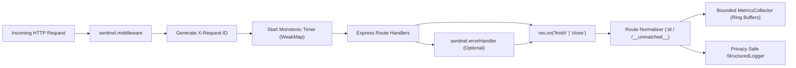

# API Sentinel (`api-sentinel-express`)

> **Monitor. Diagnose. Optimize.**
> Lightweight, privacy-first Express.js observability and API monitoring middleware with in-memory latency analytics, rolling P95 tracking, slow-request detection, and structured logging.

---

## 1. Product Overview

**API Sentinel** (`api-sentinel-express`) is a zero-dependency, developer-first observability toolkit built for Node.js and Express applications. By adding a single middleware to an Express server, developers gain immediate, real-time visibility into endpoint latency, rolling 95th percentile (P95) response times, slow endpoints, HTTP 4xx/5xx error distributions, and correlated request IDs—without sending data to external third-party servers.

---

## 2. The Problem

Modern web backends rely heavily on REST APIs, yet developers building small-to-medium Node.js applications frequently lack immediate operational visibility:

- An endpoint silently degrades to 2–3 seconds under load.
- Certain routes intermittently return HTTP 500 or HTTP 429 responses.
- Dynamic URLs (`/api/products/101`, `/api/products/102`) make per-endpoint performance hard to aggregate without high-cardinality memory leaks.
- Correlating an application error with its originating HTTP request requires grepping raw console logs.
- Naive request loggers accidentally capture passwords, `Authorization` headers, cookies, or database credentials in stack traces.

---

## 3. Our Solution

API Sentinel bridges the gap between raw terminal output and heavy enterprise APM agents:

- **One-Line Middleware Integration**: Plugs directly into Express 4 and Express 5.
- **Bounded In-Memory Storage**: Uses fixed-capacity circular ring buffers (`Float64Array` for latency windows) and route cardinality caps so memory usage never grows unbounded.
- **Privacy-First Defaults**: Never captures request bodies, query parameters, authorization tokens, cookies, or raw stack traces.
- **Dual Module Compatibility**: Ships both ESM (`dist/index.js`) and CommonJS (`dist/index.cjs`) bundles built from clean, modern JavaScript.

---

## 4. Core Features

1. **Automatic Request & Response Tracking**: Observes every HTTP request from arrival until response completion (`finish`) or premature client disconnect (`close`).
2. **High-Resolution Latency Analytics**: Measures duration via `performance.now()` and computes average, minimum, maximum, and rolling-window **P95** response times.
3. **Configurable Slow API Detection**: Flags requests exceeding `slowRequestThresholdMs` (default `500ms`), increments slow counters, and emits structured `'slow-request'` warnings.
4. **HTTP Status & Error Classification**: Tracks `1xx`, `2xx`, `3xx`, `4xx`, `404`, `5xx`, unmatched routes, and aborted requests.
5. **Cryptographic Request ID Correlation**: Generates UUID v4 identifiers via `crypto.randomUUID()`, attaches `X-Request-ID` response headers, and correlates logs and metrics.
6. **Intelligent Route Normalization**: Collapses Express route templates (`/api/products/:id`), dynamic UUIDs/ObjectIds/numeric segments, and unmatched 404s (`/__unmatched__`).
7. **Structured Machine-Readable Logging**: Emits whitelisted JSON events with configurable filters and complete failure isolation.
8. **Express Error-Handler Helper**: `sentinel.errorHandler` captures safe error classification metadata (`errorName`, `errorCode`) and forwards errors via `next(err)`.

---

## 5. Architecture Overview



---

## 6. Installation & Requirements

```bash
npm install api-sentinel-express
```

### Supported Runtime & Framework Versions

- **Node.js**: `>= 20.0.0` (Verified on Node.js 22.x and 24.x)
- **Express.js**: `^4.18.0 || ^5.0.0` (Peer dependency)
- **Module Formats**: ES Modules (`import`) and CommonJS (`require`)

---

## 7. Quick-Start Example

```javascript
import express from 'express';
import { createApiSentinel } from 'api-sentinel-express';

const app = express();
const sentinel = createApiSentinel({
  slowRequestThresholdMs: 500,
});

app.use(sentinel.middleware);

app.get('/api/users', (req, res) => {
  res.json({ users: [{ id: 1, name: 'Aarav' }] });
});

app.get('/internal/metrics', (req, res) => {
  res.json(sentinel.getMetrics());
});

app.listen(3000);
```

---

## 8. Complete Express Integration Example (With Error Handler)

```javascript
import express from 'express';
import { createApiSentinel } from 'api-sentinel-express';

const app = express();
app.use(express.json());

const sentinel = createApiSentinel({
  slowRequestThresholdMs: 350,
  maxRecentRequests: 200,
  maxRouteEntries: 100,
  windowSampleSize: 1000,
  ignorePaths: ['/internal/metrics', '/healthz'],
  logging: {
    enabled: true,
    logSlowRequests: true,
    logServerErrors: true,
    logClientErrors: false,
    logAllRequests: false,
  },
});

// 1. Register request monitoring middleware before routes
app.use(sentinel.middleware);

app.get('/api/products/:id', (req, res) => {
  res.json({ id: req.params.id, status: 'available' });
});

app.get('/api/orders/fail', (req, res, next) => {
  const err = new Error('Database timeout on internal host');
  err.name = 'DatabaseTimeoutError';
  err.code = 'ETIMEDOUT';
  next(err);
});

// Internal observability endpoint (protect in production!)
app.get('/internal/metrics', (req, res) => {
  res.json({
    metrics: sentinel.getMetrics(),
    recentRequests: sentinel.getRecentRequests(25),
    endpoints: sentinel.getEndpointMetrics(),
  });
});

// 2. Register API Sentinel error handler after routes and before final error responder
app.use(sentinel.errorHandler);

app.use((err, req, res, next) => {
  res.status(500).json({ error: 'Internal Server Error' });
});

app.listen(4000);
```

---

## 9. Configuration Reference

| Option | Type | Default | Description |
| :--- | :--- | :--- | :--- |
| `slowRequestThresholdMs` | `number` | `500` | Latency threshold (ms) above which a request is marked `isSlow: true` (`1`–`3,600,000`). |
| `maxRecentRequests` | `number` | `200` | Maximum recent request records retained in the circular history buffer (`1`–`50,000`). |
| `maxRouteEntries` | `number` | `100` | Maximum distinct `(method + normalized route)` keys tracked before overflow bucket aggregation (`2`–`10,000`). |
| `windowSampleSize` | `number` | `1000` | Capacity of the rolling `Float64Array` window for P95 latency calculations (`10`–`50,000`). |
| `requestIdHeader` | `string` | `'X-Request-ID'` | Outgoing HTTP response header name for the request correlation ID. |
| `trustIncomingRequestId` | `boolean` | `false` | When `true`, accepts a client-supplied request ID header if it matches `/^[A-Za-z0-9_-]{8,64}$/`. |
| `logging` | `boolean \| object` | `true` | `false` to disable logging, or `{ enabled, logSlowRequests, logServerErrors, logClientErrors, logAllRequests, writer }`. |
| `ignorePaths` | `Array<string\|RegExp> \| Function` | `[]` | Paths, regex patterns, or `(req) => boolean` predicate to exclude from monitoring. |
| `fallbackRouteLabel` | `string` | `'/__overflow_routes__'` | Synthetic route label for the cardinality overflow bucket. |
| `unmatchedRouteLabel` | `string` | `'/__unmatched__'` | Synthetic route label for unmatched HTTP 404 responses. |

---

## 10. Public API Reference

Calling `const sentinel = createApiSentinel(options)` returns a frozen object with:

- **`sentinel.middleware`**: Express middleware `(req, res, next) => void`.
- **`sentinel.errorHandler`**: Express error middleware `(err, req, res, next) => void`.
- **`sentinel.getMetrics()`**: Returns a detached, deeply cloned aggregate metrics snapshot.
- **`sentinel.getRecentRequests(limit?)`**: Returns an array of recent request records ordered from newest to oldest.
- **`sentinel.getEndpointMetrics()`**: Returns an array of per-endpoint analytics sorted by request volume.
- **`sentinel.resetMetrics()`**: Clears all in-memory counters, endpoint metrics, latency samples, and recent request records.
- **`sentinel.getConfig()`**: Returns the resolved, frozen configuration object.

---

## 11. Example Metrics Response (`sentinel.getMetrics()`)

```json
{
  "generatedAt": "2026-11-18T15:30:12.410Z",
  "startedAt": "2026-11-18T15:25:00.000Z",
  "uptimeSeconds": 312.41,
  "totalRequests": 42,
  "informationalRequests": 0,
  "successfulRequests": 36,
  "redirectRequests": 0,
  "notModifiedRequests": 0,
  "clientErrorRequests": 4,
  "serverErrorRequests": 2,
  "notFoundRequests": 2,
  "unmatchedRouteRequests": 2,
  "slowRequests": 3,
  "abortedRequests": 0,
  "errorRate": 14.29,
  "slowRequestRate": 7.14,
  "latency": {
    "avgMs": 48.62,
    "minMs": 2.14,
    "maxMs": 612.85,
    "p95Ms": 485.2,
    "sampleCount": 42
  },
  "statusDistribution": {
    "1xx": 0,
    "2xx": 36,
    "3xx": 0,
    "4xx": 4,
    "5xx": 2
  },
  "statusCodeCounts": {
    "200": 34,
    "201": 2,
    "400": 2,
    "404": 2,
    "500": 2
  },
  "endpoints": [
    {
      "key": "GET /api/products/:id",
      "method": "GET",
      "route": "/api/products/:id",
      "requestCount": 25,
      "informationalCount": 0,
      "successCount": 25,
      "redirectCount": 0,
      "notModifiedCount": 0,
      "errorCount": 0,
      "clientErrorCount": 0,
      "serverErrorCount": 0,
      "slowRequestCount": 0,
      "avgDurationMs": 14.3,
      "minDurationMs": 8.12,
      "maxDurationMs": 28.4,
      "p95DurationMs": 25.1,
      "lastSeenAt": "2026-11-18T15:30:10.100Z",
      "isOverflowBucket": false
    }
  ],
  "cardinalityOverflowCount": 0,
  "config": {
    "slowRequestThresholdMs": 350,
    "maxRecentRequests": 200,
    "maxRouteEntries": 100,
    "windowSampleSize": 1000,
    "requestIdHeader": "X-Request-ID"
  }
}
```

---

## 12. Structured Logging Output Examples

When a request exceeds `slowRequestThresholdMs`:

```json
{
  "type": "slow-request",
  "requestId": "8f1d4e9a-3c2b-4d7a-9e1f-5b6a7c8d9e0f",
  "method": "GET",
  "route": "/api/demo/slow",
  "statusCode": 200,
  "durationMs": 542.18,
  "timestamp": "2026-11-18T15:30:05.120Z",
  "outcome": "success",
  "isSlow": true,
  "isUnmatchedRoute": false,
  "aborted": false
}
```

When an error traverses `sentinel.errorHandler`:

```json
{
  "type": "error-detected",
  "requestId": "c4a1b2d3-8e9f-4a5b-8c7d-1e2f3a4b5c6d",
  "method": "GET",
  "route": "/api/demo/error",
  "statusCode": 500,
  "durationMs": 16.42,
  "timestamp": "2026-11-18T15:30:09.811Z",
  "outcome": "server_error",
  "isSlow": false,
  "isUnmatchedRoute": false,
  "errorName": "DatabasePoolExhaustedError",
  "errorCode": "ECONNREFUSED"
}
```

---

## 13. Privacy and Security Guarantees

- **Zero External Telemetry**: Never phones home or opens network connections.
- **No Sensitive Payload Capture**: Never inspects `req.body`, `Authorization` headers, cookies, or query parameters (`?token=...` is stripped before normalization).
- **Safe Error Metadata Only**: Strips `err.message` and `err.stack` so credentials or SQL statements in exception messages cannot leak into metrics.
- **Untrusted External Request IDs by Default**: Generates fresh UUID v4 identifiers unless `trustIncomingRequestId: true` is configured and passes strict `/^[A-Za-z0-9_-]{8,64}$/` validation.
- See [SECURITY.md](./SECURITY.md) for the full security policy.

---

## 14. Performance & Actual Benchmark Results

Run the reproducible benchmark script with:

```bash
npm run benchmark
```

### Actual Measured Benchmark (`benchmarks/overhead-benchmark.js`)

- **Environment**: Apple M4 (`darwin arm64`, 10 logical cores), Node.js `v22.23.0` / `v24.14.0`
- **Workload**: `1,500` HTTP GET requests (`/api/items/:id`) at concurrency `25` following a `200`-request warmup phase (`logging: false` to measure pure middleware & metrics aggregation overhead).

| Scenario | Requests / sec | Avg Latency (ms) | P95 Latency (ms) | Total Time (ms) |
| :--- | ---: | ---: | ---: | ---: |
| **Baseline Express (No Middleware)** | `13,024.53` | `1.902 ms` | `2.41 ms` | `115.17 ms` |
| **Express + API Sentinel Middleware** | `14,952.35` | `1.663 ms` | `2.65 ms` | `100.32 ms` |

- **P95 Latency Delta**: `+0.24 ms` (`2.65 ms` vs. `2.41 ms`).
- **Interpretation**: Per-request recording uses $O(1)$ circular buffers (`Float64Array`) and `WeakMap` lookups, adding sub-millisecond overhead (~`0.24 ms` at P95) that falls within normal V8 JIT execution variance.

---

## 15. Testing & Code Coverage

```bash
# Run unit and integration test suite
npm test

# Run test suite with V8 coverage
npm run test:coverage

# Run ESLint & Prettier verification
npm run lint
npm run format:check
```

### Verified Coverage (`34 / 34` tests passing across 3 test files)

- **Statements**: `97.35%` (Target: `>= 90%`)
- **Branches**: `87.67%` (Target: `>= 85%`)
- **Functions**: `98.11%` (Target: `>= 90%`)
- **Lines**: `97.35%` (Target: `>= 90%`)

---

## 16. Separate Consumer Demonstration Application (`api-sentinel-demo`)

A complete full-stack Express + React (Vite) observability application is located in the sibling directory `../api-sentinel-demo`:

```bash
# Terminal 1 — Start the Express Demo Backend (Port 4000)
cd ../api-sentinel-demo/backend
npm install
npm start

# Terminal 2 — Start the React Observability Dashboard (Port 5173)
cd ../api-sentinel-demo/frontend
npm install
npm run dev
```

Open `http://localhost:5173` to interactively trigger normal 2xx requests, slow requests (`>350ms`), client errors (`400` / `404`), server errors (`500`), and 15-request bursts.

---

## 17. Troubleshooting

- **Routes show dynamic paths instead of `:id` templates**: Ensure `app.use(sentinel.middleware)` is registered **before** your routes so its `res.on('finish')` listener runs after Express populates `req.route.path`.
- **`errorName` is missing on 500 responses**: Register `app.use(sentinel.errorHandler)` **after** your routes and **before** your final Express error responder.
- **Metrics reset when server restarts**: API Sentinel uses in-memory storage; metrics are process-local and reset on process restart or `nodemon`/`node --watch` reload.

---

## 18. Limitations & Known Constraints

1. **Process-Local In-Memory Storage**: Metrics are stored in the current Node.js process RAM and are not automatically shared across multiple cluster workers or containers.
2. **Rolling Window P95**: P95 latency is calculated over the most recent `windowSampleSize` (default `1,000`) requests rather than lifetime unbounded history.
3. **Express-Specific Middleware**: Designed specifically for Express 4 and Express 5 applications.

---

## 19. Documentation Index

- [Architecture Guide](./docs/ARCHITECTURE.md)
- [Complete API Reference](./docs/API_REFERENCE.md)
- [Engineering Design Decisions](./docs/DESIGN_DECISIONS.md)
- [Testing & Coverage Report](./docs/TESTING.md)
- [Security & Privacy Policy](./SECURITY.md)
- [Future Product Roadmap](./docs/FUTURE_ROADMAP.md)
- [NPM Publishing Guide](./NPM_PUBLISHING_GUIDE.md)
- [University Viva Preparation Guide](./VIVA_PREPARATION.md)
- [University Submission Guide](./SUBMISSION.md)

---

## 20. Repository & Package Links

- **GitHub Repository (Package)**: `https://github.com/<YOUR_GITHUB_USERNAME>/api-sentinel-express` *(configure placeholder after pushing)*
- **NPM Registry Page**: `https://www.npmjs.com/package/api-sentinel-express` *(available upon running `npm publish`)*
- **GitHub Repository (Consumer Demo Application)**: `https://github.com/<YOUR_GITHUB_USERNAME>/api-sentinel-demo` *(configure placeholder after pushing)*

---

## 21. License

Released under the [MIT License](./LICENSE).
