# 🛡️ API Sentinel (`api-sentinel-express`)

**A lightweight, production-oriented API observability and monitoring middleware for Node.js and Express.js.**

The package helps developers monitor, diagnose, and analyze API traffic directly inside their Express applications — delivering real-time request telemetry, rolling P95 latency analytics, slow-endpoint detection, HTTP status and error classification, cryptographic request ID correlation, and privacy-first structured logging with **zero runtime dependencies**.

[](https://www.npmjs.com/package/api-sentinel-express)
[](https://www.npmjs.com/package/api-sentinel-express)
[](https://github.com/aviiixbuilds/api-sentinel-express/blob/main/LICENSE)
[](https://github.com/aviiixbuilds/api-sentinel-express)
[](https://github-profile-checker-xzs3.onrender.com)

---

## 📖 Product Introduction

### The Problem

Developers often struggle to understand what is happening inside their Express APIs after deployment. Once an application begins serving live traffic, critical operational questions emerge:

- Which endpoints are experiencing **failed requests** or elevated **HTTP 4xx / 5xx error rates**?
- Which routes silently degrade into **slow endpoints** under real user workloads?
- What are the **average response latency** and **95th percentile (P95) latency** across the service?
- How is **endpoint-level performance** distributed across parameterized routes like `/api/users/:id` without causing high-cardinality memory leaks?
- What happened during **recent request activity**, and how can a specific failed response be correlated with server logs?

Building custom instrumentation from scratch is repetitive and error-prone, while naive request loggers frequently leak sensitive request bodies, query strings, authorization tokens, or raw stack traces.

### The Solution

**API Sentinel** (`api-sentinel-express`) is a developer-focused API monitoring toolkit that adds a lightweight, in-memory observability layer directly to Express 4 and Express 5 applications.

By registering a single middleware, developers get bounded in-memory latency and error analytics, automatic route template normalization, `X-Request-ID` tracing, and sanitized structured logging — without external agents, database dependencies, or third-party telemetry servers. It is purpose-built for single-process Node.js services, developer dashboards, and internal diagnostics rather than as a replacement for distributed enterprise APM platforms.

---

## ✨ Features

- **⚡ Real-Time HTTP Request Tracking** — Observes every incoming Express request from arrival through response completion (`finish`) or premature client disconnection (`close`) using monotonic `performance.now()` timers stored in a leak-free `WeakMap`.
- **📊 Automatic HTTP Status & Error Classification** — Categorizes traffic across mutually exclusive status families (`1xx`, `2xx`, `3xx`, `4xx`, `5xx`), while specifically distinguishing `2xx` successes, `3xx` redirects, `304 Not Modified` cache hits, `4xx` client errors, `404 Not Found` responses, `5xx` server errors, and aborted connections (`499`).
- **🐢 Configurable Slow Request Detection** — Automatically flags any request exceeding `slowRequestThresholdMs` (default `500ms`), increments global and per-endpoint slow counters, computes `slowRequestRate`, and emits structured `'slow-request'` warning events.
- **📈 Average, Min/Max & Rolling P95 Latency Analytics** — Tracks minimum, maximum, and average duration alongside a rolling-window **95th percentile (P95)** latency calculated via the nearest-rank algorithm over pre-allocated `Float64Array` circular ring buffers (`RollingWindowSampler`).
- **🧭 Endpoint-Level Aggregation & Route Template Normalization** — Resolves mounted Express route templates (`req.baseUrl + req.route.path`, such as `GET /api/github/users/:username`), collapses dynamic UUIDs, MongoDB ObjectIds, hex hashes, long opaque tokens, and numeric IDs into `:id`, and groups unmatched `404` URLs under `/__unmatched__`.
- **🛡️ Bounded Memory & Cardinality Protection** — Enforces strict upper bounds on tracked routes (`maxRouteEntries`, default `100`), recent request history (`maxRecentRequests`, default `200`), and latency sample windows (`windowSampleSize`, default `1000`). Excess unseen routes are automatically merged into a fallback overflow bucket (`ALL /__overflow_routes__`).
- **🔗 Cryptographic Request ID Generation & Correlation** — Generates UUID v4 identifiers via `node:crypto` (`randomUUID()`), attaches the configured `X-Request-ID` response header, exposes `res.locals.requestId`, and correlates recent request records with structured log output.
- **🕒 Bounded Recent Request History** — Retains the most recent completed requests in a fixed-capacity circular buffer and returns detached, newest-first snapshots via `sentinel.getRecentRequests(limit)`.
- **📝 Privacy-First Structured Logging** — Emits machine-readable JSON log events (`'slow-request'`, `'server-error'`, `'client-error'`, `'error-detected'`, `'request-completed'`) to console streams or a custom `writer` callback, wrapped in complete `try / catch` failure isolation so logging errors can never crash the host server.
- **🔒 Strict Request & Error Sanitization** — Never captures request bodies (`req.body`), query strings (`?token=...`), `Authorization` headers, cookies, or raw error messages and stack traces (`err.message`, `err.stack`). Its optional `sentinel.errorHandler` records only validated `errorName` and `errorCode` identifiers before forwarding errors via `next(err)`.
- **📦 Zero Dependencies & Dual ESM / CommonJS Bundles** — Built with `esbuild` into both ES Module (`dist/index.js`) and CommonJS (`dist/index.cjs`) distributions with zero runtime dependencies.

---

## 🚀 Live Demo & Example Project

**API Sentinel** is integrated as a real production runtime dependency inside a separate, deployed full-stack Express application (**GitHub Profile Checker**):

- **🌐 Live Deployed Demo**: [https://github-profile-checker-xzs3.onrender.com](https://github-profile-checker-xzs3.onrender.com)
- **💻 Consumer Project Deployed Link**: [https://github-profile-checker-xzs3.onrender.com](https://github-profile-checker-xzs3.onrender.com)
- **📦 API Sentinel NPM Package**: [https://www.npmjs.com/package/api-sentinel-express](https://www.npmjs.com/package/api-sentinel-express)
- **🛠️ Package Source Repository**: [https://github.com/aviiixbuilds/api-sentinel-express](https://github.com/aviiixbuilds/api-sentinel-express)

### What You Can Explore in the Live Consumer Demo

The **GitHub Profile Checker** consumer application installs `api-sentinel-express` from NPM to monitor its Express backend while serving a GitHub profile lookup interface. Visitors to the live demo can explore:

- **GitHub Profile Search & Repository Lookup** *(Consumer Application Features)* — Search for real GitHub usernames, view profile statistics, and browse public repositories through the Express backend (`/api/github/users/:username` and `/api/github/users/:username/repos`).
- **Live API Request Monitoring & Latency Analytics** *(Powered by `api-sentinel-express`)* — Observe real-time updates to total requests, `2xx` successful requests, average latency, rolling P95 latency, endpoint-level metrics, and recent request logs as searches are performed.
- **Interactive Error Classification & Slow-Request Simulation** *(Consumer Demo Controls Powered by `api-sentinel-express`)* — Trigger safe test requests for normal responses (`200`), slow requests (`>400ms`), client errors (`400`), and server errors (`500`) to see how API Sentinel classifies outcomes and captures `errorName` / `errorCode` metadata in real time.

> **Note**: GitHub profile search, repository lookup, and the visual dashboard UI belong to the consumer application (`github-profile-checker-`), while `api-sentinel-express` provides the underlying Express middleware, in-memory metrics collector, rolling P95 engine, error classification handler, and programmatic telemetry APIs.

---

## 📦 Installation

Install the package from the public NPM registry:

```bash
npm install api-sentinel-express
```

### Runtime & Framework Requirements

| Requirement | Supported Versions | Notes |
| :--- | :--- | :--- |
| **Node.js** | `>= 20.0.0` | Verified on Node.js 20.x, 22.x, and 24.x (`engines.node` in `package.json`). |
| **Express.js** | `^4.18.0 \|\| ^5.0.0` | Declared as a `peerDependency`. Works with both Express 4 and Express 5. |
| **Module Formats** | ESM & CommonJS | Supports both `import { createApiSentinel } from 'api-sentinel-express'` and `require('api-sentinel-express')`. |
| **Runtime Dependencies** | `0` | Relies exclusively on built-in Node.js modules (`node:crypto`, `node:perf_hooks`). |

---

## ⚡ Quick Start

Register `sentinel.middleware` **before** your application routes so API Sentinel can time the full request lifecycle and resolve mounted Express route templates (`req.route.path`):

```javascript
import express from 'express';
import { createApiSentinel } from 'api-sentinel-express';

const app = express();

// 1. Initialize API Sentinel with custom or default configuration
const sentinel = createApiSentinel({
  slowRequestThresholdMs: 500,
  ignorePaths: ['/internal/metrics'],
});

// 2. Register the request-tracking middleware BEFORE your application routes
app.use(sentinel.middleware);

// 3. Define your Express application routes
app.get('/api/users/:id', (req, res) => {
  res.status(200).json({
    id: req.params.id,
    name: 'Aarav Sharma',
    requestId: res.locals.requestId, // Populated automatically by API Sentinel
  });
});

// 4. Expose an internal observability route to inspect collected metrics
app.get('/internal/metrics', (req, res) => {
  res.status(200).json(sentinel.getMetrics());
});

// 5. Start the Express server
const PORT = process.env.PORT || 3000;
app.listen(PORT, () => {
  console.log(`Server running on http://localhost:${PORT}`);
});
```

### CommonJS Usage

```javascript
const express = require('express');
const { createApiSentinel } = require('api-sentinel-express');

const app = express();
const sentinel = createApiSentinel({ slowRequestThresholdMs: 400 });

app.use(sentinel.middleware);
```

---

## 🛠️ Advanced Usage

### 1. Custom Configuration

Configure custom thresholds, ring-buffer capacities, path exclusions (strings, regular expressions, or a predicate function), and route labels:

```javascript
import { createApiSentinel } from 'api-sentinel-express';

const sentinel = createApiSentinel({
  slowRequestThresholdMs: 350,
  maxRecentRequests: 250,
  maxRouteEntries: 120,
  windowSampleSize: 1000,
  requestIdHeader: 'X-Request-ID',
  trustIncomingRequestId: false,
  ignorePaths: [
    '/healthz',
    '/internal/metrics',
    /^\/assets\//,
  ],
  fallbackRouteLabel: '/__overflow_routes__',
  unmatchedRouteLabel: '/__unmatched__',
});

// Inspect the frozen resolved configuration at any time
console.log(sentinel.getConfig());
```

You can also pass a predicate function `(req) => boolean` to `ignorePaths`:

```javascript
const sentinel = createApiSentinel({
  ignorePaths: (req) => req.path.startsWith('/static/') || req.path === '/healthz',
});
```

---

### 2. Structured Logging & Custom Log Writers

By default, API Sentinel emits sanitized JSON lines for slow requests (`console.warn`) and server errors (`console.error`). You can customize which event types are logged or route all structured events into your own logger (such as Pino or Winston) via `logging.writer`:

```javascript
import { createApiSentinel } from 'api-sentinel-express';

const sentinel = createApiSentinel({
  slowRequestThresholdMs: 400,
  logging: {
    enabled: true,
    logSlowRequests: true,
    logServerErrors: true,
    logClientErrors: true,
    logAllRequests: false,
    writer: (event) => {
      // `event` is a frozen, sanitized object containing only whitelisted telemetry fields
      process.stdout.write(`${JSON.stringify(event)}\n`);
    },
  },
});
```

Pass `logging: false` to disable structured log output entirely while keeping in-memory metrics collection active.

#### Structured Log Event Example (`slow-request`)

```json
{
  "type": "slow-request",
  "requestId": "8f1d4e9a-3c2b-4d7a-9e1f-5b6a7c8d9e0f",
  "method": "GET",
  "route": "/api/reports/generate",
  "statusCode": 200,
  "durationMs": 542.18,
  "timestamp": "2026-11-18T15:30:05.120Z",
  "outcome": "success",
  "isSlow": true,
  "isUnmatchedRoute": false,
  "aborted": false
}
```

---

### 3. Programmatic Metrics Retrieval & Reset

Every read method on the API Sentinel instance returns a **deeply detached copy** so external callers cannot mutate internal collector buffers:

```javascript
// 1. Full aggregate metrics snapshot (counters, rates, global latency, status counts, endpoints)
const metrics = sentinel.getMetrics();

// 2. Most recent completed requests (ordered newest to oldest, optional limit)
const latestTenRequests = sentinel.getRecentRequests(10);

// 3. Per-endpoint metrics array sorted by highest request volume
const endpointBreakdown = sentinel.getEndpointMetrics();

// 4. Reset all in-memory counters, rolling P95 buffers, and recent request history
sentinel.resetMetrics();
```

---

### 4. Express Error Handling Integration (`sentinel.errorHandler`)

Register `sentinel.errorHandler` **after** all application routes and **before** your final Express error responder. It extracts only safe classification metadata (`errorName` and optional `errorCode`), attaches it to the request record, emits an `'error-detected'` event (when `logServerErrors: true`), and forwards the error via `next(err)`:

```javascript
import express from 'express';
import { createApiSentinel } from 'api-sentinel-express';

const app = express();
const sentinel = createApiSentinel();

// 1. Register request tracking middleware first
app.use(sentinel.middleware);

app.get('/api/orders/checkout', (req, res, next) => {
  const err = new Error('Connection refused on internal database host 10.0.4.12');
  err.name = 'DatabaseConnectionError';
  err.code = 'ECONNREFUSED';
  next(err);
});

// 2. Register API Sentinel error handler AFTER routes
app.use(sentinel.errorHandler);

// 3. Register your application's final error responder
app.use((err, req, res, next) => {
  res.status(500).json({
    error: 'InternalServerError',
    requestId: res.locals.requestId,
  });
});
```

---

### 5. Request IDs, Route Normalization & Exported Utilities

In addition to `createApiSentinel`, the package exports its underlying pure utility functions and classes for advanced custom instrumentation or testing:

```javascript
import {
  DEFAULT_CONFIG,
  RollingWindowSampler,
  calculatePercentile,
  roundDuration,
  cleanPathString,
  normalizeDynamicPathSegments,
  resolveNormalizedRoute,
  generateRequestId,
  isValidIncomingRequestId,
  resolveRequestId,
  extractSafeErrorMetadata,
  sanitizeLogEvent,
  resolveAndValidateConfig,
} from 'api-sentinel-express';

// Compute nearest-rank P95 over an array of latency samples
const p95 = calculatePercentile([12.4, 18.2, 25.0, 41.8, 310.5], 95);

// Strip query parameters and normalize dynamic UUIDs/IDs into :id placeholders
const normalized = normalizeDynamicPathSegments(
  '/api/users/550e8400-e29b-41d4-a716-446655440000/orders/98765?token=secret'
);
// -> '/api/users/:id/orders/:id'
```

---

## ⚙️ Configuration Reference

All options passed to `createApiSentinel(options)` are validated at initialization time (`resolveAndValidateConfig`). Invalid types throw a `TypeError` and out-of-range numbers throw a `RangeError`.

| Option | Type | Default | Description |
| :--- | :--- | :--- | :--- |
| `slowRequestThresholdMs` | `number` | `500` | Latency threshold in milliseconds above which a request is marked `isSlow: true` (`durationMs > slowRequestThresholdMs`). Valid range: `1` to `3,600,000`. |
| `maxRecentRequests` | `number` | `200` | Maximum number of recent request records retained in the circular history buffer. Must be an integer between `1` and `50,000`. |
| `maxRouteEntries` | `number` | `100` | Maximum distinct `(METHOD + route)` keys tracked before least-used/excess routes are merged into the overflow bucket. Must be an integer between `2` and `10,000`. |
| `windowSampleSize` | `number` | `1000` | Capacity of the pre-allocated `Float64Array` rolling window used for global and per-endpoint P95 latency calculations. Must be an integer between `10` and `50,000`. |
| `requestIdHeader` | `string` | `'X-Request-ID'` | HTTP response header name used to attach the request correlation ID (and inspected on incoming requests when `trustIncomingRequestId: true`). Must be a valid HTTP header token. |
| `trustIncomingRequestId` | `boolean` | `false` | When `false`, always generates a fresh UUID v4. When `true`, reuses an incoming `requestIdHeader` value only if it matches `/^[A-Za-z0-9_-]{8,64}$/`. |
| `logging` | `boolean \| object` | `true` | Pass `false` to disable all log output, `true` for default settings, or a configuration object (see table below). |
| `ignorePaths` | `Array<string\|RegExp> \| Function` | `[]` | Array of exact path strings, `RegExp` patterns tested against the cleaned path, or a predicate `(req) => boolean` returning `true` for requests to exclude from monitoring. |
| `fallbackRouteLabel` | `string` | `'/__overflow_routes__'` | Synthetic route label assigned to the cardinality overflow bucket (`ALL /__overflow_routes__`). Must start with `'/'`. |
| `unmatchedRouteLabel` | `string` | `'/__unmatched__'` | Synthetic route label assigned to unmatched HTTP `404` requests where `req.route` is undefined. Must start with `'/'`. |

### `logging` Sub-Options Reference

| Property | Type | Default | Description |
| :--- | :--- | :--- | :--- |
| `logging.enabled` | `boolean` | `true` | Master switch for structured log emission. |
| `logging.logSlowRequests` | `boolean` | `true` | Emits a `'slow-request'` event (`console.warn`) when `durationMs > slowRequestThresholdMs`. |
| `logging.logServerErrors` | `boolean` | `true` | Emits `'server-error'` (`statusCode >= 500`) and `'error-detected'` (via `sentinel.errorHandler`) events (`console.error`). |
| `logging.logClientErrors` | `boolean` | `false` | Emits a `'client-error'` event (`console.warn`) for HTTP `400–499` responses. |
| `logging.logAllRequests` | `boolean` | `false` | Emits a `'request-completed'` event (`console.info`) for normal requests that did not already trigger a slow or error log. |
| `logging.writer` | `Function \| undefined` | `undefined` | Optional callback `(sanitizedEvent) => void` that receives the frozen log event object instead of writing to `console.*`. |

---

## 📊 Metrics and Analytics

### 1. Aggregate Snapshot (`sentinel.getMetrics()`)

Calling `sentinel.getMetrics()` returns an immutable snapshot with global request counters, error and slow rates (as percentages rounded to 2 decimal places), latency statistics, mutually exclusive `statusDistribution` counts, exact `statusCodeCounts`, per-endpoint breakdowns, and active configuration metadata.

#### Illustrative Sample Output (`sentinel.getMetrics()`)

```json
{
  "generatedAt": "2026-11-20T12:15:30.410Z",
  "startedAt": "2026-11-20T12:00:00.000Z",
  "uptimeSeconds": 930.41,
  "totalRequests": 50,
  "informationalRequests": 0,
  "successfulRequests": 42,
  "redirectRequests": 1,
  "notModifiedRequests": 1,
  "clientErrorRequests": 4,
  "serverErrorRequests": 2,
  "notFoundRequests": 2,
  "unmatchedRouteRequests": 1,
  "slowRequests": 3,
  "abortedRequests": 0,
  "errorRate": 12,
  "slowRequestRate": 6,
  "latency": {
    "avgMs": 64.25,
    "minMs": 1.42,
    "maxMs": 584.1,
    "p95Ms": 462.8,
    "sampleCount": 50
  },
  "statusDistribution": {
    "1xx": 0,
    "2xx": 42,
    "3xx": 2,
    "4xx": 4,
    "5xx": 2
  },
  "statusCodeCounts": {
    "200": 40,
    "201": 2,
    "302": 1,
    "304": 1,
    "400": 2,
    "404": 2,
    "500": 2
  },
  "endpoints": [
    {
      "key": "GET /api/github/users/:username",
      "method": "GET",
      "route": "/api/github/users/:username",
      "requestCount": 38,
      "informationalCount": 0,
      "successCount": 34,
      "redirectCount": 0,
      "notModifiedCount": 0,
      "errorCount": 4,
      "clientErrorCount": 3,
      "serverErrorCount": 1,
      "slowRequestCount": 2,
      "avgDurationMs": 58.14,
      "minDurationMs": 12.4,
      "maxDurationMs": 584.1,
      "p95DurationMs": 440.2,
      "lastSeenAt": "2026-11-20T12:15:28.900Z",
      "isOverflowBucket": false
    }
  ],
  "cardinalityOverflowCount": 0,
  "config": {
    "slowRequestThresholdMs": 400,
    "maxRecentRequests": 200,
    "maxRouteEntries": 100,
    "windowSampleSize": 1000,
    "requestIdHeader": "X-Request-ID"
  }
}
```

### 2. Recent Request History (`sentinel.getRecentRequests(limit?)`)

Returns an array of recent request telemetry records ordered from **newest to oldest**. Each record contains:

```json
[
  {
    "requestId": "68681fc0-eceb-4e32-beec-d5c31c8170a9",
    "timestamp": "2026-11-20T12:15:28.900Z",
    "method": "GET",
    "route": "/api/monitoring/demo/server-error",
    "statusCode": 500,
    "durationMs": 1.34,
    "isSlow": false,
    "outcome": "server_error",
    "isUnmatchedRoute": false,
    "aborted": false,
    "errorName": "SimulatedServerError",
    "errorCode": "EDEMO_500"
  }
]
```

### Diagnosing Bottlenecks with These Metrics

- **High `p95Ms` with Low `avgMs`**: Indicates tail-latency spikes affecting a subset of requests even when average performance appears healthy.
- **Per-Endpoint `slowRequestCount` & `p95DurationMs`**: Pinpoints which specific route template (e.g., `GET /api/github/users/:username`) is responsible for latency degradation.
- **`unmatchedRouteRequests` vs. `notFoundRequests`**: Separates application-level `404` responses (such as a missing user ID on a valid route) from unmatched URL probes (`/__unmatched__`).
- **`errorName` and `errorCode` on Recent Requests**: Identifies the failure class (e.g., `GitHubUpstreamError`, `ETIMEDOUT`) alongside the `requestId` without exposing sensitive payloads.

---

## 🔒 Privacy and Security

API Sentinel is engineered with privacy-conscious defaults so operational telemetry can be collected without storing sensitive user or application secrets:

### What Is Collected
- HTTP method (`GET`, `POST`, etc.) and normalized route template (`/api/users/:id` or `/__unmatched__`).
- HTTP status code (`200`, `404`, `500`, etc.) and semantic outcome classification (`'success'`, `'client_error'`, `'server_error'`, `'redirect'`, `'not_modified'`, `'informational'`).
- High-resolution request duration in milliseconds (`durationMs`) and slow-request boolean flag (`isSlow`).
- Generated UUID v4 `requestId` and ISO-8601 completion `timestamp`.
- Sanitized error class name (`errorName`, validated against `/^[A-Za-z0-9_.:-]+$/` and truncated to 80 characters) and error code (`errorCode`, truncated to 64 characters) when `sentinel.errorHandler` is used.

### What Is Deliberately Excluded
- **Request & Response Bodies**: `req.body` and outgoing payloads are never read, cloned, or logged.
- **Query Parameters & URL Fragments**: `cleanPathString()` strips `?query=...` and `#hash` segments before route normalization or logging.
- **Headers & Cookies**: `Authorization`, `Cookie`, `Set-Cookie`, API keys, and client IP addresses are never stored in metrics or log events.
- **Raw Exception Messages & Stack Traces**: `extractSafeErrorMetadata()` ignores `err.message` and `err.stack` so SQL queries, file paths, or connection credentials inside error messages cannot leak into metrics.
- **Unvalidated External Request IDs**: Incoming `X-Request-ID` headers are ignored by default (`trustIncomingRequestId: false`), and when enabled are strictly validated against `/^[A-Za-z0-9_-]{8,64}$/` to mitigate header-splitting and log-injection payloads.

> **Production Recommendation**: `api-sentinel-express` never mounts public HTTP endpoints automatically. If you expose `sentinel.getMetrics()` on an HTTP route in production, protect that route with authentication or internal network restrictions.

---

## 🧪 Testing & Development

The package uses **Vitest** (`vitest`) and **Supertest** (`supertest`) for unit and Express integration testing, **V8 Coverage** (`@vitest/coverage-v8`) for coverage verification, **ESLint** (`eslint`) and **Prettier** (`prettier`) for code quality, and **esbuild** (`scripts/build.js`) for bundling.

### Available NPM Scripts

| Command | Description |
| :--- | :--- |
| `npm test` | Runs the complete unit and integration test suite once (`vitest run`). |
| `npm run test:watch` | Runs Vitest in interactive watch mode (`vitest`). |
| `npm run test:coverage` | Runs the test suite with V8 code coverage analysis (`vitest run --coverage`). |
| `npm run lint` | Lints `src`, `tests`, `examples`, `benchmarks`, and `scripts` with ESLint. |
| `npm run format` | Formats all JavaScript files using Prettier. |
| `npm run format:check` | Verifies code formatting with Prettier without modifying files. |
| `npm run build` | Builds dual ESM (`dist/index.js`) and CommonJS (`dist/index.cjs`) bundles via `scripts/build.js`. |
| `npm run benchmark` | Runs the reproducible Express latency overhead benchmark (`benchmarks/overhead-benchmark.js`). |

### Verified Test & Coverage Results (Current Test Suite Run)

From the current test suite execution across `tests/unit/core-algorithms.test.js`, `tests/unit/validation-and-utils.test.js`, and `tests/integration/express-middleware.test.js`:

- **Statements**: `97.83%` (`1355 / 1385` — configured threshold: `>= 90%`)
- **Branches**: `88.53%` (`309 / 349` — configured threshold: `>= 85%`)
- **Functions**: `98.11%` (`52 / 53` — configured threshold: `>= 90%`)
- **Lines**: `97.83%` (`1355 / 1385` — configured threshold: `>= 90%`)

*(Note: These coverage figures reflect the current automated test run in this repository and may vary as code evolves.)*

### Local Contributor Setup

```bash
# 1. Clone the repository
git clone https://github.com/aviiixbuilds/api-sentinel-express.git
cd api-sentinel-express

# 2. Install development dependencies
npm install

# 3. Run linting, format verification, tests, and build
npm run lint
npm run format:check
npm test
npm run build
```

---

## 🏗️ Architecture and Technical Implementation

```mermaid
flowchart LR
    Req["Incoming Express Request"] --> Ignore{"Matches ignorePaths?"}
    Ignore -- "Yes" --> NextSkip["next() (Bypass Monitoring)"]
    Ignore -- "No" --> ReqID["Resolve / Generate X-Request-ID"]
    ReqID --> Context["Store Start Time in WeakMap (performance.now)"]
    Context --> Route["Express Route Handlers"]
    Route -- "next(err)" --> ErrMW["sentinel.errorHandler (Extract errorName & errorCode)"]
    Route --> Lifecycle["res.on('finish' | 'close')"]
    ErrMW --> Lifecycle
    Lifecycle --> Norm["Route Normalizer (req.route.path / :id / /__unmatched__)"]
    Norm --> Classify["Classify Status, Duration & Slow Flag"]
    Classify --> Collector["Bounded MetricsCollector (Float64Array & Ring Buffers)"]
    Classify --> Logger["Privacy-Safe StructuredLogger"]
    Collector --> ReadAPI["getMetrics() / getRecentRequests() / getEndpointMetrics()"]
```



### Internal Lifecycle Flow

1. **Incoming Request & Path Filtering**: `sentinel.middleware` checks `shouldIgnoreRequest(req, config.ignorePaths)`. Ignored requests immediately call `next()` with zero allocation.
2. **Request ID & `WeakMap` Context**: `resolveRequestId()` generates a UUID v4 (or validates an incoming header if `trustIncomingRequestId: true`), sets the outgoing `X-Request-ID` header and `res.locals.requestId`, and stores `{ requestId, startTimeMs }` in a `WeakMap` keyed by `req`.
3. **Optional Error Metadata Capture**: If an error passes through `sentinel.errorHandler`, `extractSafeErrorMetadata(err)` records the sanitized `errorName` and `errorCode` onto the active `WeakMap` context and forwards `next(err)`.
4. **Completion & Route Normalization**: A one-time finalizer attached to `res.on('finish')` and `res.on('close')` calculates elapsed time via `performance.now()`. If the connection closed before `res.writableEnded`, it marks `aborted: true` (and assigns status `499` if the status was still `200`). `resolveNormalizedRoute()` derives the canonical route template.
5. **Bounded Metrics Aggregation**: `MetricsCollector.recordRequest()` updates status counters, inserts the latency sample into the global and per-endpoint `RollingWindowSampler` (`Float64Array`), appends a cloned record to `recentRequestsBuffer`, and enforces `maxRouteEntries` via `/__overflow_routes__`.
6. **Sanitized Structured Logging**: `StructuredLogger.logCompletedRequest()` passes whitelisted fields through `sanitizeLogEvent()` and emits JSON events according to the active `logging` filters.

---

## 📁 Project Structure

```text
api-sentinel-express/
├── src/
│   ├── index.js                        # Public package entry point & exports
│   ├── config/
│   │   └── defaults.js                 # DEFAULT_CONFIG constants & CONFIG_BOUNDS
│   ├── core/
│   │   ├── metrics-collector.js        # Bounded in-memory MetricsCollector & ring buffers
│   │   ├── percentile.js               # RollingWindowSampler (Float64Array) & nearest-rank P95
│   │   ├── request-tracker.js          # WeakMap request context, timer & status classifier
│   │   └── route-normalizer.js         # Query stripping, :id normalization & route resolution
│   ├── middleware/
│   │   ├── create-middleware.js        # Primary Express request-tracking middleware
│   │   └── error-handler.js            # Express error-handling middleware (errorHandler)
│   └── utils/
│       ├── logger.js                   # Failure-isolated StructuredLogger
│       ├── request-id.js               # UUID v4 generation & incoming header validation
│       ├── sanitizer.js                # Log event whitelisting & safe error metadata extraction
│       └── validation.js               # Configuration validation & default resolution
├── dist/
│   ├── index.js                        # Built ES Module bundle (+ index.js.map)
│   └── index.cjs                       # Built CommonJS bundle (+ index.cjs.map)
├── tests/
│   ├── fixtures/
│   │   └── test-app.js                 # Express test application fixture
│   ├── integration/
│   │   └── express-middleware.test.js  # End-to-end Express & CJS/ESM bundle integration tests
│   └── unit/
│       ├── core-algorithms.test.js     # Unit tests for P95, route normalization & collector bounds
│       └── validation-and-utils.test.js# Unit tests for config validation, request IDs & sanitizer
├── examples/
│   └── basic-express-app.js            # Runnable Express example server
├── benchmarks/
│   └── overhead-benchmark.js           # Reproducible throughput & P95 overhead benchmark
├── scripts/
│   └── build.js                        # esbuild dual ESM/CJS bundler script
├── docs/                               # Supplementary architecture, API, testing & design docs
├── package.json
├── vitest.config.js
├── eslint.config.js
├── CHANGELOG.md
├── SECURITY.md
├── LICENSE
└── README.md
```

---

## ⚠️ Limitations and Compatibility

- **Express-Specific Middleware**: Designed for **Express.js** (`^4.18.0 || ^5.0.0`) and relies on Express conventions (`req.baseUrl`, `req.route.path`, `res.locals`, and `(err, req, res, next)` error middleware).
- **Node.js Runtime**: Requires **Node.js `>= 20.0.0`**.
- **Process-Local In-Memory Retention**: All counters, latency buffers, and recent requests are stored in the memory of the running Node.js process. Metrics reset to zero whenever the process restarts or redeploys.
- **Single-Instance Scope**: In multi-process clusters (such as Node `cluster`, PM2 cluster mode, or multi-replica container deployments), each worker maintains its own independent in-memory metrics snapshot rather than aggregating across replicas.
- **Rolling Window P95**: Both global and per-endpoint P95 values are calculated over the most recent `windowSampleSize` requests (default `1,000`) to guarantee bounded memory usage.

---

## 📄 License

This project is open source and available under the [MIT License](./LICENSE).

---

## 👨‍💻 Author

**Aviral Dwivedi**

- **GitHub**: [@aviiixbuilds](https://github.com/aviiixbuilds)
- **NPM Package**: [api-sentinel-express](https://www.npmjs.com/package/api-sentinel-express)
- **Package Repository**: [https://github.com/aviiixbuilds/api-sentinel-express](https://github.com/aviiixbuilds/api-sentinel-express)
