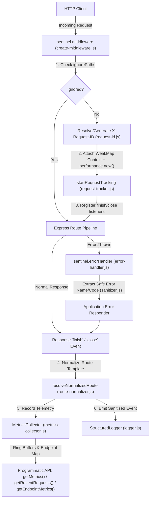

# System Architecture — API Sentinel (`api-sentinel-express`)

## 1. Architectural Overview

**API Sentinel** is a lightweight, in-process observability middleware SDK for Node.js and Express applications. It follows a strict layered architecture with zero external runtime dependencies, separating HTTP lifecycle interception, route normalization, bounded in-memory aggregation, and privacy-sanitized structured logging.

---

## 2. Module Responsibilities

| Module | File Path | Primary Responsibility |
| :--- | :--- | :--- |
| **Public Facade** | `src/index.js` | Exposes `createApiSentinel(options)` and wires configuration, collector, logger, and middlewares into a frozen instance. |
| **Defaults** | `src/config/defaults.js` | Centralizes default configuration constants (`slowRequestThresholdMs: 500`, `maxRecentRequests: 200`, `maxRouteEntries: 100`, `windowSampleSize: 1000`) and validation bounds. |
| **Validation** | `src/utils/validation.js` | Performs fail-fast runtime validation on all user configuration options, throwing descriptive `TypeError` or `RangeError` exceptions on invalid input. |
| **Request ID** | `src/utils/request-id.js` | Generates collision-free UUID v4 identifiers via `node:crypto` (`randomUUID()`) and validates incoming headers when `trustIncomingRequestId: true`. |
| **Privacy Sanitizer** | `src/utils/sanitizer.js` | Enforces a strict field whitelist on structured log events (`sanitizeLogEvent`) and strips sensitive stack traces/messages from errors (`extractSafeErrorMetadata`). |
| **Structured Logger** | `src/utils/logger.js` | Emits JSON-formatted telemetry events (`slow-request`, `server-error`, `client-error`, `error-detected`, `request-completed`) with full `try / catch` failure isolation. |
| **Percentile Engine** | `src/core/percentile.js` | Implements nearest-rank percentile computation and `RollingWindowSampler` using a fixed-capacity `Float64Array` circular buffer. |
| **Route Normalizer** | `src/core/route-normalizer.js` | Resolves Express `req.baseUrl + req.route.path`, strips query strings, collapses dynamic path segments (`:id`), and groups unmatched 404s under `/__unmatched__`. |
| **Request Tracker** | `src/core/request-tracker.js` | Stores per-request timing (`performance.now()`) and safe error metadata in a `WeakMap` keyed by the Express `req` object, and classifies HTTP status codes. |
| **Metrics Collector** | `src/core/metrics-collector.js` | Maintains global counters, bounded circular history (`maxRecentRequests`), bounded endpoint map (`maxRouteEntries` with overflow bucket), and returns detached deep snapshots. |
| **Request Middleware** | `src/middleware/create-middleware.js` | Non-intrusive Express middleware that hooks `res.on('finish')` and `res.on('close')` with a one-time completion guard (`finalized`) so requests are never double-counted. |
| **Error Middleware** | `src/middleware/error-handler.js` | Express 4-argument error middleware `(err, req, res, next)` that attaches safe error metadata to the request context and forwards `next(err)`. |

---

## 3. Memory Bounds & Data Structures

Long-running Node.js servers cannot store unbounded arrays of request logs or latency numbers without suffering out-of-memory (OOM) crashes. API Sentinel enforces three strict memory bounds:

1. **Recent Request Ring Buffer (`maxRecentRequests`, default `200`)**:
   - Backed by a fixed-length array `new Array(config.maxRecentRequests)` and a modular write pointer `recentWriteIndex = (recentWriteIndex + 1) % maxRecentRequests`.
   - Recording a request is $O(1)$ and never allocates a growing array.
2. **Rolling Latency Window (`windowSampleSize`, default `1000`)**:
   - Backed by a contiguous typed array `new Float64Array(capacity)` (only 8 KB per 1,000 samples).
   - Overwrites the oldest sample in $O(1)$ time once the window is full.
3. **Endpoint Cardinality Cap (`maxRouteEntries`, default `100`)**:
   - Unmatched 404 routes are automatically collapsed into `/__unmatched__`.
   - Dynamic path segments (UUIDs, ObjectIds, integers, long tokens) are normalized into `:id`.
   - If the number of distinct endpoints reaches `maxRouteEntries`, excess routes are merged into a dedicated fallback bucket (`ALL /__overflow_routes__`) and `cardinalityOverflowCount` is incremented.
